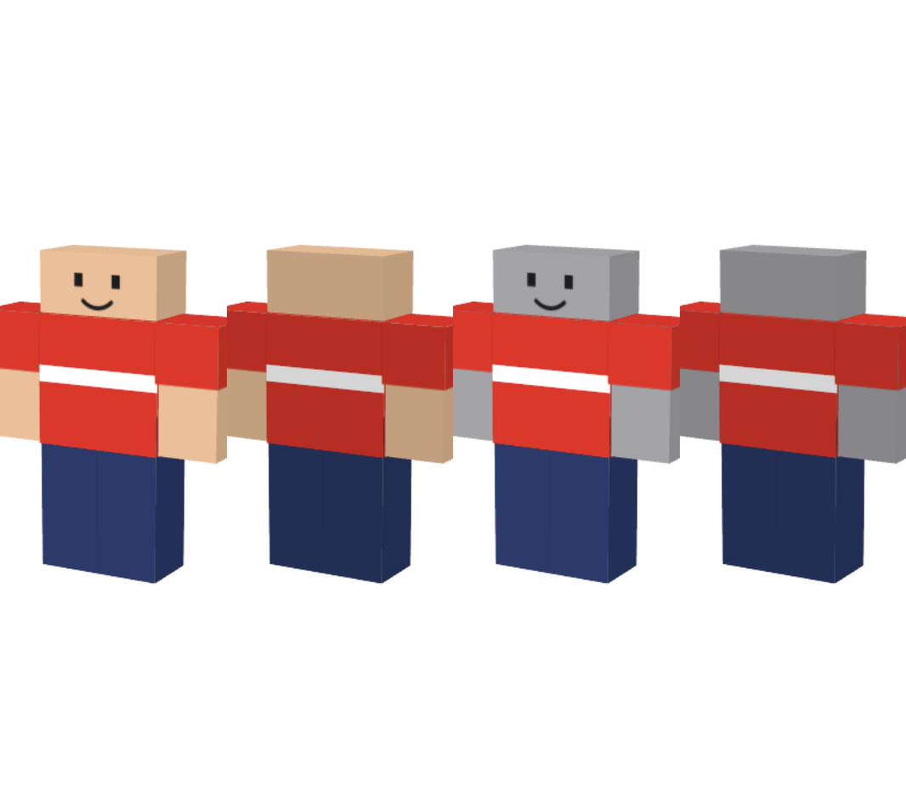

# Rokit

A small Windows desktop app built with [MyGo](https://github.com/egoist/mygo) (Go backend, TypeScript page, system WebView2).
It converts audio with `ffmpeg`, extracts video frames, downloads videos with `yt-dlp`, and downloads Roblox assets.
The Rust/egui version of the audio editor lives on the `main` branch.

## Tabs

| Tab | What it does |
|---|---|
| Audio | mp3, wav, flac, ogg, m4a, opus. Bitrate 64–320 kbps (off for wav/flac), speed 0.25×–4× (pitch kept, chained `atempo`), volume ±20 dB, mono/stereo/keep. Input: a file or a URL (yt-dlp). Progress from `ffmpeg -progress`. |
| Video ke Gambar | PNG or JPG frames (JPG quality 1–100), 0.5–60 fps or every frame, into a new folder (never overwrites). Cancel removes the partial folder. |
| Unduh Video | One video via yt-dlp: best/1080/720/480/360, mp4 or as-is, saved to Downloads under its title. |
| Aset Roblox | Anonymous check and download of a Roblox asset, or a pasted list. See below. |
| Pakaian Klasik | 3D preview of Roblox Classic Shirt/Pants PNGs on an R6 avatar. See below. |

Themes (picker in the sidebar, saved in `%APPDATA%\Rokit\settings.json`): Otomatis, Apple Terang, Gelap, Material Terang, Material Gelap, OLED, Kaca.

## Aset Roblox

Paste an asset **ID**, `rbxassetid://ID`, or a URL on `roblox.com`, `www.roblox.com`, `create.roblox.com` or `assetdelivery.roblox.com`
(`/library/ID`, `/catalog/ID`, `/marketplace/asset/ID`, `/store/asset/ID`, `?id=ID`). Any other host or scheme is rejected.

- **Login is optional (Masuk Roblox).** Without it the app calls only public endpoints, with no cookie. With it, the button opens the official `roblox.com/login` in its own window with its own in-memory web session; you type your password there, the app never sees it. The app reads the resulting `.ROBLOSECURITY` session cookie, checks it with `users.roblox.com/v1/users/authenticated`, and keeps it in the Windows Credential Manager. It is sent only over https to `assetdelivery.roblox.com`, `economy.roblox.com` and `users.roblox.com`, never to the CDN or anywhere else, and is never logged. *Keluar* deletes it from the app (the session on roblox.com stays valid until you sign out there). The login only opens what that account may open; assets it cannot open stop with a clear message. While logged in, "Unduh semua" looks assets up one by one (the batch call would need a CSRF token). The first time, a dialog explains all of this and asks "Lanjut" or "Batal". Where things live: the cookie is in the Windows Credential Manager as `com.znxae.rokit/roblox-session` (dev builds: `com.znxae.rokit.dev/...`), the account name and ID as `.../roblox-account`; `%APPDATA%\Rokit\settings.json` holds only the theme and `loginNoticeSeen`. The cookie is never logged, never written to a file, never shown in the page or in error messages. A leaked session cookie gives full account access, so use this only from a copy you trust or built yourself. Untested against a real login: it needs your account.
- Endpoints: `economy.roblox.com/v2/assets/ID/details` (name, type, creator) and `assetdelivery.roblox.com/v2/assetId/ID` (download location). "Unduh semua" first asks `POST assetdelivery.roblox.com/v2/assets/batch` for all locations at once.
  Roblox reports delivery errors as HTTP 200 with an `errors` list (401 login needed, 403/409 not authorized, 404 not found).
- Downloads are followed only to `https://*.rbxcdn.com`.
- Saved to `Downloads\Rokit-Roblox\<id>-<name>.<ext>`, never overwriting (`(1)`, `(2)`, …).
- Extension comes from the file's real bytes: audio `.ogg`/`.mp3`, images `.png`, meshes `.mesh` (raw Roblox format), models/hats/accessories `.rbxmx` or `.rbxm` (raw, open in Roblox Studio).
- **Decal / Face / Shirt / Pants / T-Shirt** are small public XML wrappers. The app reads the image ID inside and downloads that image as PNG, and says "Decal -> gambar ID xxx". A Decal's ID is not its Image's ID.
- **Options** (single download, after Cek): *Versi* downloads an older published version (`.../version/N`, saved as `...-vN`); *Model Avatar* (hats, accessories, heads) asks for the avatar-ready mesh model with the `Roblox-AssetFormat` header; *Format mesh: OBJ* converts a Mesh to `.obj` (v1-v4 mesh files, first LOD, skinning ignored; v4 is not yet checked against a real file). Version and Avatar cannot be combined.
- Unknown bytes fall back to the type: Place `.rbxl`, Model/Animation/Plugin `.rbxm`.
- Audio: "Buka di tab Audio" loads the saved file as the Audio tab's input.
- Use only assets you own or whose license allows it, and follow Roblox's Terms of Use.

### Limits

| Limit | Value |
|---|---|
| Asset size | 200 MB |
| Metadata/delivery request timeout | 20 s each |
| One asset, all requests | 3 min |
| Wrapper XML read for Decal etc. | 1 MB |
| "Unduh semua" list | max 50 lines, one per line, sequential |
| "Unduh semua" pace | 1 request per second (each asset needs about 3 requests) |
| HTTP 429 | honors `Retry-After`: a list waits up to 60 s and retries that asset once; otherwise it stops and marks the rest skipped. A single download shows "Terlalu banyak permintaan, coba lagi nanti" |
| User-Agent | `Rokit-Asset-Downloader/1.0` |

What works without login (checked live): Audio, Image, Mesh, public Decals, Shirt/Pants templates, Hats and accessories.
Many Decals, Images, Models and Places answer 401/403/409 and cannot be downloaded without login.

## Pakaian Klasik

Preview a Classic Shirt and/or Pants image (PNG, exactly 585x559, up to 4 MB) on a 3D R6 avatar, both layers at once. Drag a PNG onto a box or use *Pilih gambar*; wrong files are refused with a reason (`ukuran harus 585x559, gambar Anda WxH`). Drag to rotate, scroll to zoom; options: template lines on the avatar, auto-rotate, background (theme / checker / transparent), *Simpan gambar preview*. *Unduh template panduan* saves our own labelled guide (drawn by the app, not Roblox's image). Files go to `Downloads\Rokit-Pakaian`, never overwriting.

- **Avatar kita**: a username or user ID is looked up with public endpoints (`users.roblox.com`, `avatar.roblox.com`, no cookie) and its body colors are applied; *Avatar saya* uses the logged-in account's ID, still without sending the cookie. Empty = a neutral default avatar with our own face. The preview always uses the **R6 shape**, even for R15 users.
- **Layout source**: the 585x559 regions were measured from Roblox's published Classic Clothing template (analysis only, the template is not shipped) and match the size table in the Creator docs: 128x128 front/back, 64x128 sides, 128x64 top/bottom, 64x64 arm/leg ends. Pants use the same layout. Shirt covers torso and arms, pants the legs and lower torso; transparent pixels show the body color. Orientation was checked with a labelled test image on all four sides. The table and the PNG checks have tests (`npm run test:ts`, `go test ./...`).
- **three.js** 0.187.0 (MIT) is a pinned npm dependency bundled into the page; no CDN, works offline. Textures use linear filtering; how closely that matches Roblox's own rendering is unverified.
- **Not included**: uploading to Roblox. *Buka halaman unggah Roblox* only opens `create.roblox.com` in your browser; uploading needs your account, a fee and your decision. Hats/accessories (v2) are not drawn; `mesh.go` could be reused for that.



## Requirements

- Windows 10/11 with WebView2 (preinstalled on Windows 11).
- Nothing else with the portable zip: it carries `ffmpeg`, `ffprobe` and `yt-dlp` in a `bin` folder next to the exe.
  The app looks in `<exe folder>\bin` first, then on PATH (so a dev build with ffmpeg/yt-dlp on PATH still works).
  The "Alat" row on the Unduh Video tab shows which copies are in use and their versions; **Perbarui yt-dlp** downloads the latest
  official yt-dlp release into `bin` after checking its SHA-256 against the release's `SHA2-256SUMS`.
  If `bin` is empty and nothing is on PATH the app says "Alat bawaan ... tidak ditemukan; pasang ulang aplikasi".

## Build the portable zip

```
npx mygo build
powershell -File scripts\fetch-tools.ps1     # pinned yt-dlp + ffmpeg (LGPL build) into .tools\bin, SHA-256 checked against tools.lock
powershell -File scripts\package.ps1         # release\Rokit-<version>-win64.zip
```

`tools.lock` pins the exact URLs and hashes (official sources only: github.com/yt-dlp/yt-dlp and github.com/FFmpeg-Builds/FFmpeg-Builds
releases); the script fails on any mismatch and runs nothing but `--version` after the hashes match. No binaries are committed
(`.tools\` and `release\` are git-ignored). Licenses: ffmpeg is LGPL-3.0-or-later, yt-dlp is the Unlicense; see `THIRD_PARTY_NOTICES.md`
(also in the zip, with the source-offer links and `licenses\ffmpeg-LICENSE.txt`). Bumping a tool means editing `tools.lock`
with the publisher's new URL and checksum.

## Run the built app

```
release\Rokit-0.1.0-win64.zip                       (portable, with bin\; the thing to distribute)
build\windows-amd64\Rokit Audio Editor.exe          (exe only; needs ffmpeg/yt-dlp on PATH or a bin folder beside it)
build\windows-amd64\rokit-audio-editor-setup-0.1.0-amd64.exe   (installer)
```

## Develop and build

Needs Go 1.27+, Node 24+.

```
npm install
npx mygo dev        # live reload window
npx mygo build      # writes build\windows-amd64\
go test ./...       # unit tests
npm run typecheck
ROKIT_LIVE=1 go test -run TestLive -v ./...   # real Roblox endpoints (needs network)
```

`npx mygo generate` rewrites `src/mygo.ts` from the Go service when its methods change.

The window has no native title bar: the page draws macOS-style buttons (MyGo `TitleBarHidden` + `HideWindowButtons`), which keeps the native resize edge, shadow and corners.
